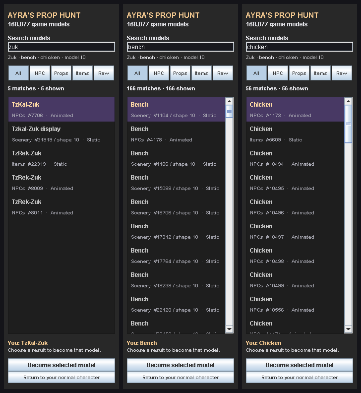

<!-- Copyright (c) 2026, Drew. SPDX-License-Identifier: BSD-2-Clause -->
# Ayra's Prop Hunt

Just a fun little mod for people who got that dog in them.

Become Zuk, a bench, a chicken, or any other model in the bundled game catalog.
This is a cosmetic character replacement with optional RuneLite Party sharing.



## Pick a model

1. Enable **Ayra's Prop Hunt** and click its **box icon** in RuneLite's sidebar.
2. Type a name such as `Zuk`, `bench`, or `chicken` into **Search models**.
3. Choose a result and click **Become selected model**, double-click it, or press Enter.

The dropdown has been replaced by a searchable list with **All / NPC / Props /
Items / Raw** filters. Down Arrow moves from the search field into the results;
Enter applies the highlighted result. Model names, types, catalog numbers, and
whether an animation is available are shown in each row. Search work runs off
the game and UI threads. The list shows at most 250 results at once; refine your
search or include a catalog number to find a particular variant.

Use **Return to your normal character** to remove your disguise. The chosen model
is saved in your RuneLite profile and restored the next time you enable the plugin.

## Catalog and animations

The current cache snapshot provides **168,077 searchable entries**:

| Kind | Entries |
| --- | ---: |
| NPCs | 17,000 |
| Scenery objects and shape variants | 67,836 |
| Item models | 20,167 |
| Raw game meshes | 63,074 |

Named variants and composed definitions can share underlying meshes. The raw
category covers the complete model-index snapshot, including unnamed and partial
meshes. Scenery variants preserve the relevant shape's parts, colors, textures,
scale, offsets, and mirroring. No game meshes are bundled with the plugin: the
metadata identifies models which RuneLite loads from the game's cache.

NPCs use their own idle, walking, and running sequences where defined. Matching
attack animations are resolved from the game's named animation data and play
when your character attacks; the real player's action animation is untouched.
For example, Zuk uses Zuk's idle and attack, and chickens use their own walk and
attack. Missing movement sequences fall back to that model's idle. Props without
animations stay static and move with your character, as in prop hunt. Animated
scenery keeps its own ambient animation.

Attack sequences are not universally specified in NPC definitions. Only known
matching attacks are used; no arbitrary human animation is applied to an unknown
rig. Raw meshes have no NPC animation assignment and stay static. Some raw
entries are individual body parts, effects, or meshes intended for special engine
rendering. If a mesh has not loaded yet, the original character remains visible
until it is ready; a missing sequence can display its static mesh while loading.
New game models require a regenerated metadata snapshot.

## Party appearances

Everyone must use **this version**, enable RuneLite's **Party** plugin, and join
the same party passphrase. In Prop Hunt settings, turn on **Share with party**;
sharing defaults to off. **Show party props** controls whether you see other
opted-in members' selected models. Non-users stay human. No party is joined or
changed automatically, and there is no global appearance relay.

Other players' replacements are disabled in the Wilderness, PvP areas, and
PvP/Deadman/Bounty/Arena/LMS/tournament worlds. Targets across the Wilderness ditch
also remain human. Your own cosmetic model remains enabled. Hover a replaced
player to reveal their original model for native player interactions.

Only your in-game name, world, selected catalog key, protocol version, and enabled
state are shared with your current RuneLite Party. No coordinates, gear, chat,
credentials, or combat data are transmitted. Opt-outs are immediate; disconnected
clients expire after 45 seconds. Initial connections may take about 12 seconds.
Older Doggies clients use a different protocol and must update.

## Build and sideload

Requires a JDK 11 or newer; tested with JDK 17.

```powershell
.\gradlew.bat test release
```

The release is `ayras-prop-hunt-2.0.0.jar`. Close your developer client and run
`.\tools\Install-PropHunt.ps1` to install it and disable older Dog Mode/Doggies builds.
Restart RuneLite, enable **Ayra's Prop Hunt**, and open the box sidebar icon.
The stock RuneLite launcher does not load sideloaded JARs.

For source development, temporarily disable the installed Prop Hunt JAR to avoid
loading the same plugin twice, then use `.\gradlew.bat run`.

`.\gradlew.bat preview` renders the actual searchable sidebar offline. Tests cover
catalog completeness, searching and keyboard selection, static props, model
animation choices, attack replay, opt-in/out, message validation, world/PvP
restrictions, expiry, loading, and lifecycle cleanup. Live in-game visual and
two-client multiplayer verification remain necessary.

## Catalog maintenance

The catalog is generated read-only using RuneLite's cache decoder. The tool is a
separate developer project whose dependencies are excluded from the plugin JAR:

```powershell
.\gradlew.bat -p tools/catalog generate
```

Use `-PcacheDir=<cache-directory>` for a different cache. Rebuild and test the plugin
after regenerating. Runtime assets use RuneLite's public model and animation APIs.
This is a developer-sideloaded plugin. RuneLite
[closed and locked the original submission](https://github.com/runelite/plugin-hub/pull/21351#issuecomment-7178531985)
under its restriction on plugins that significantly alter in-game content or
assets. It is not distributed through the Plugin Hub; passing builds and tests
do not constitute RuneLite/Jagex approval.
